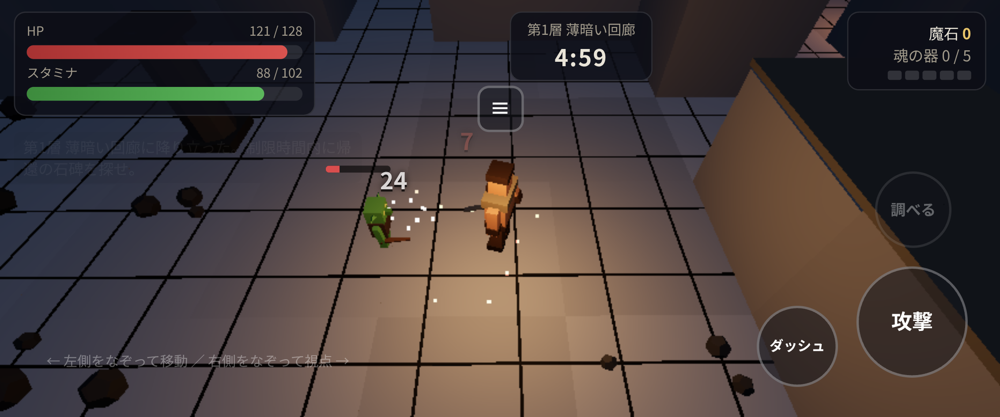
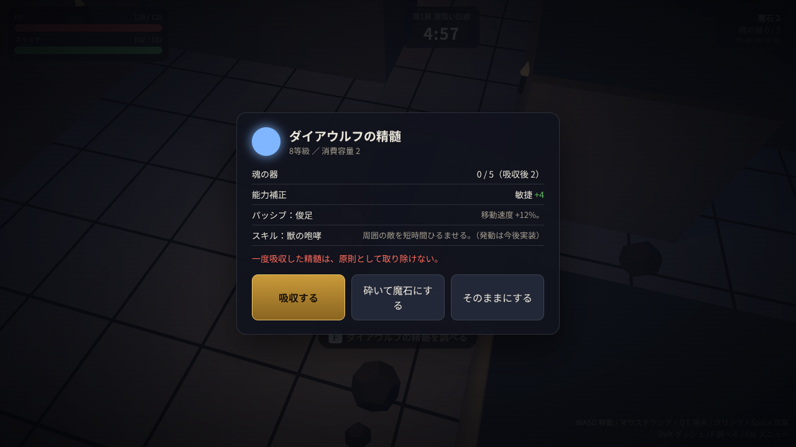

# 精髄の迷宮（ESSENCE LABYRINTH）

一人称視点の 3D ダンジョン探索型 RPG。ゲーム本体は Web 技術（Three.js）で作り、将来 Android アプリ（Capacitor）と
Windows 用ソフト（Electron）として配布する予定です。開発方針は [CLAUDE.md](CLAUDE.md) を参照。


| ストーンゴーレム | スマホ（タッチ操作） | 精髄の吸収 |
|---|---|---|
|  |  |  |

## 遊び方（開発中の確認）

```bash
cd web
python3 -m http.server 8000
# ブラウザで http://localhost:8000/ を開く（スマホからは同じ LAN の PC の IP:8000）
```

| 操作 | PC | スマホ |
|---|---|---|
| 移動 | W S 前後・A D 横歩き / ↑↓ | 画面左側をなぞる（仮想スティック） |
| 視点 | マウス（画面をクリックするとマウスがゲームに固定される。ドラッグでも可）/ Q・E / ←→ | 画面右側をなぞる |
| 攻撃 | 左クリック / Space / J | 攻撃ボタン |
| ダッシュ | Shift | ダッシュボタン（押している間） |
| 調べる（精髄・帰還の石碑） | F / Enter | 調べるボタン |
| メニュー（一時停止） | Esc / P（マウスの固定も外れる） | ≡ ボタン |

### Step 1 でできること

* 一人称視点で第1層（4m 四方のマス目でできた回廊と部屋）を探索。制限時間 5 分
* 敵 3 種（ゴブリン・ダイアウルフ・ストーンゴーレム）。索敵・経路探索で追跡し、予備動作（赤く光る）のあとに攻撃
* 近接攻撃（スタミナ消費）、ダッシュ。ヒットストップ・ノックバック・ダメージ数字・粒子で手応えを表現
* 倒すと魔石（自動で拾う）と、確率で精髄オーブを落とす
* 精髄の吸収：魂の器（容量 5）の範囲内で吸収。同じ精髄の重複不可・取り除けない。吸収するとステータスとパッシブが即座に反映
  （吸収できない精髄は砕いて魔石にできる）
* 帰還の石碑で帰還すると魔石を持ち帰れる。時間切れは魔石半減、力尽きると全損
* セーブは自動（吸収した精髄・魔石・記録）。画質の切り替え（高：PC 向け／低：スマホ向け）

## 構成

```
web/                … ゲーム本体（Android・PC 共通）
  index.html        … 画面（HUD・タッチ操作・タイトル・吸収・メニュー・結果）
  game.js           … ゲームループ、ダンジョン、プレイヤー、敵 AI、戦闘、精髄、タイマー
  models.js         … キャラクター・モンスター・アイテムのローポリモデル（基本形状の組み合わせ）
  data.js           … マスターデータ（種族・精髄・モンスター・階層・古文書）。数値の調整はここ
  storage.js        … セーブ・ロード（保存先を差し替えられるよう抽象化）
  input.js          … 入力の抽象化（キーボード／マウス／タッチ）
  vendor/three/     … Three.js r170（同梱。CDN 不要）
blender/
  bpy_kit.py         … 形を組む部品（箱・円柱・リング・チューブ・球）、マテリアル（単色・画像・写真素材の PBR）、
                        当たり判定と「調べる」対象の記録、glTF への書き出し、テクスチャの JPEG 化
  fetch_textures.py  … Poly Haven（CC0）から PBR テクスチャと HDRI を取得
  text_textures.py   … 日本語の看板・貼り紙などのテクスチャ作成（OS ごとのフォント自動検出、古び加工）
  example_build.py   … 使い方の例（床・レンガの壁・木箱・看板・柱と電線を作って書き出す）
  cache/             … ダウンロードした素材（git 管理外）
assets/
  models/            … 書き出したモデル（.gltf + .bin、テクスチャは models/textures/ で共有）
  textures/          … 自分で作ったテクスチャ
```

## 使い方

```bash
python3 blender/example_build.py
# → assets/models/example.gltf / example.json、blender/example.blend
```

新しいゲームでは `example_build.py` をコピーして書き換えていきます。

```python
import bpy_kit as K, fetch_textures as PH, text_textures as TT

K.reset_scene()
brick = K.pbr_mat("brick", *PH.ensure_texture("red_brick_03", "1k"), metal=0.0)  # 写真素材（実寸で繰り返す）
b = K.Builder("Stage")
b.box((-5, 4.5, 0), (5, 5, 4), brick, collide=True)   # Blender 座標（Z が上、単位 m）
obj = b.finish()
K.export_gltf(obj, "assets/models/stage.gltf")
```

* 写真素材は https://polyhaven.com で探せます（ID は URL の最後の部分）。
  `python3 blender/fetch_textures.py <ID> [1k|2k]` で単体でも取得できます。すべて CC0 です。
* `b.collider(...)` / `collide=True` で当たり判定の箱、`b.interact(...)` で「調べる」対象を記録し、
  `b.colliders_gltf()` でゲーム側（glTF / three.js の Y-up 座標）の形にして書き出せます。
* 看板の文字は `TT.sign(...)`、古び加工は `TT.weather(...)`。

## 環境

Claude Code のクラウド環境「3Dtest」で動く前提です。環境側に次の設定があります。

* セットアップスクリプト：`fonts-noto-cjk`（日本語フォント）と `bpy==5.2.3`、`pillow` をインストール
* ネットワーク：`api.polyhaven.com` と `dl.polyhaven.org` への接続を許可

手元の PC で動かす場合は Python 3.13 が必要です（bpy 5.2.3 は Python 3.13 専用）。

```bash
python3.13 -m venv .venv && source .venv/bin/activate   # Windows は .venv\Scripts\activate
pip install bpy==5.2.3 pillow
```

日本語フォントは OS の標準フォントを自動で探します（macOS: ヒラギノ、Windows: 游ゴシック／メイリオ・游明朝）。
見つからないときは環境変数 `KIT_FONT_BOLD` / `KIT_FONT_REG` / `KIT_FONT_SERIF` でフォントファイルを指定します。
