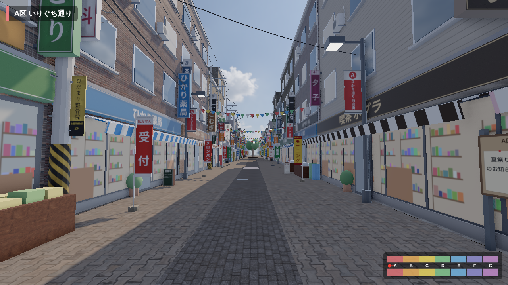
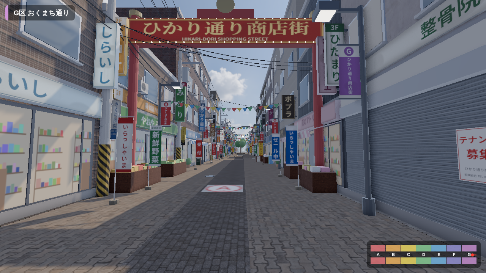
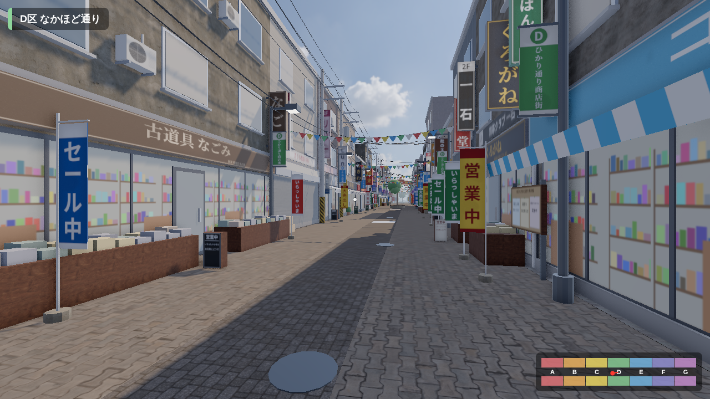
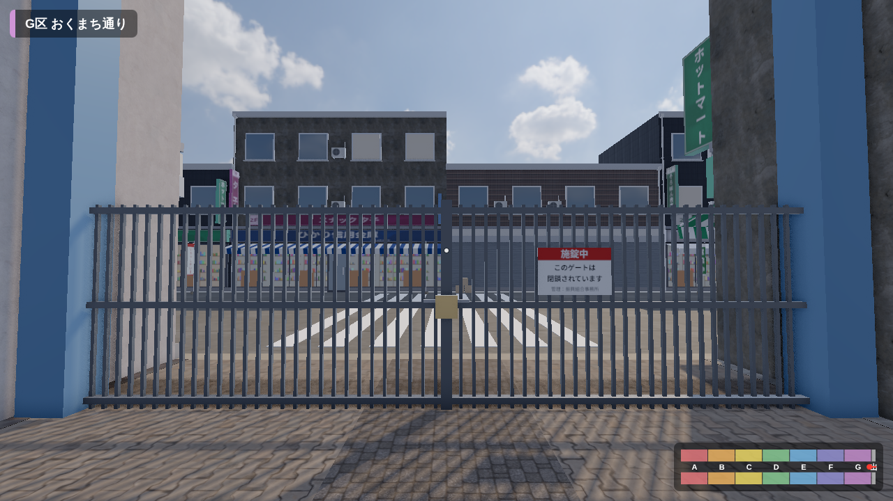
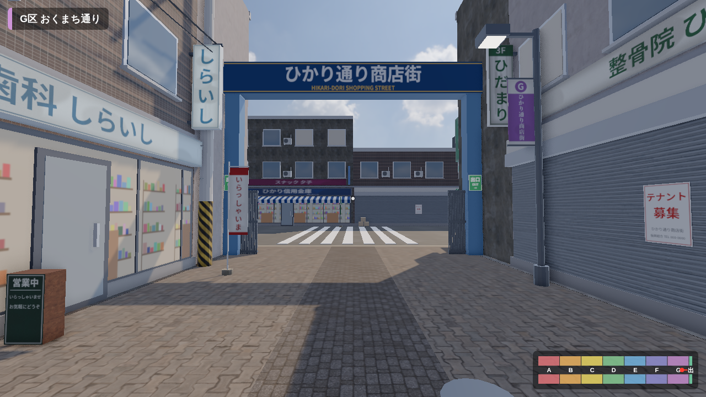
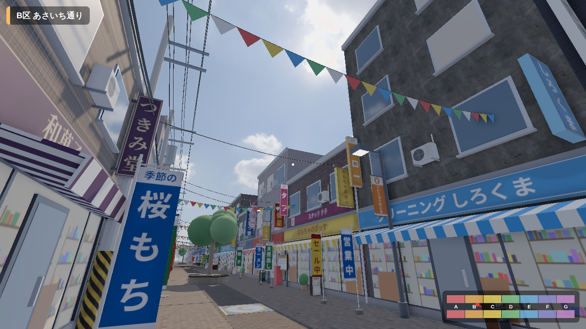

# ひかり通り商店街（脱出ゲーム用 3D 素材）

アーケードのない現代の商店街を Blender (Python / `bpy`) で生成し、
**まっすぐな 1 本道で、端のないループする通り**（脇道・路地・突き当たりなし）の商店街を、
**A〜G の区画ごとに独立した 3D モジュール (glTF)** として書き出したものです。
ブラウザ (three.js) で一人称で歩き回れるウォークスルーも同梱しています。

舗装・外壁・シャッター・木材などには [Poly Haven](https://polyhaven.com/) の写真ベースの
PBR テクスチャ（CC0）を、空と環境光には同じく Poly Haven の HDRI を使っています（[CREDITS.md](CREDITS.md)）。

雰囲気は「少しレトロで、ごちゃっとした下町の商店街」です。

* 看板：ほぼ全店に袖看板、2〜3 階のテナント看板（整骨院・麻雀・学習塾・スナックなど）。
  汚れ・日焼け・雨だれで古びさせ、老舗っぽい業種は明朝体。一部は内照式
* 店先：のぼり旗、置き看板（メニュー）、鉢植え、ビールケース、空き店舗前の段ボール
* 電柱と電線：腕金・がいし・変圧器・黄黒のトラ柄・電柱広告。通りを横切る引き込み線
* 商店街の旗とゲート：街灯の「ひかり通り商店街」フラッグ、A区入口の電球つきアーチ、通りを横切る万国旗



| 通常：G区の先はそのままA区へ続く | D区 |
|---|---|
|  |  |

| 条件達成：G区の先に出口（施錠中） | 条件達成：G区の先の出口が開く |
|---|---|
|  |  |



## 構成

```
blender/
  build_shotengai.py   … 商店街を生成して glTF / manifest / .blend を出力するメインスクリプト
  street_data.py       … 区画・店舗・テーマカラーなどのデータ（ここを編集して作り変える）
  fetch_textures.py    … Poly Haven から PBR テクスチャと HDRI を取得（使う素材の一覧もここ）
  textures.py          … 看板・貼り紙・フラッグ・店内・室外機など商店街固有の絵柄を生成 (Pillow)
  shotengai.blend      … A〜G と、その先に開いた出口を並べた編集用ファイル（ビルドで生成。git 管理外）
  cache/               … ダウンロードした素材（git 管理外）
assets/
  models/*.gltf, *.bin … 区画 section_A〜G と、出口 exit（開）/ exit_locked（施錠）
  models/textures/     … 全モジュールで共有するテクスチャ（カラー・法線・ARM＝AO/粗さ/金属）
  models/manifest.json … 長さ・当たり判定・店舗・調べられる場所の情報
  env/sky_2k.hdr       … 空と環境光の HDRI
  textures/*.png       … 生成した絵柄（Blender 用の元画像）
game/
  index.html, main.js  … ウォークスルー（ゲームの土台）
  vendor/three/        … three.js r170 とアドオン（同梱、CDN 不要）
```

## モジュール（区画）

| キー | 内容 | 長さ |
|---|---|---|
| `A` | いりぐち通り：八百屋・薬局・パン屋・花屋・喫茶・鮮魚店、掲示板 | 24 m |
| `B` | あさいち通り：精肉・豆腐・和菓子・書店など、空き店舗、郵便ポスト | 24 m |
| `C` | ひろば通り：眼鏡・電器・たい焼き・おもちゃ・ラーメン、中央に木と円形ベンチ | 24 m |
| `D` | なかほど通り：**鍵屋**、古道具、コインランドリー、金物、はんこ | 24 m |
| `E` | あかり通り：美容室・時計店・中華・靴・酒店 | 24 m |
| `F` | こかげ通り：洋品・写真館・カフェ・スポーツ・定食、中央に木 | 24 m |
| `G` | おくまち通り：自転車店・歯科・居酒屋・質屋、郵便ポスト | 24 m |

### ループする 1 本道

商店街には **端（突き当たり）がありません**。最後の区画の先は最初の区画につながっていて、
まっすぐ歩き続けると同じ通りに戻ってきます（前にも後ろにも無限に歩ける）。脇道もありません。

すべての区画は **同じ長さ (24 m)・同じ通り幅 (9 m)** で、継ぎ目がそろうように作ってあります。
そのため、どの順番で何個並べてもループがつながります。進行状況に応じて区画を増減する場合も、
並べ方を変えるだけで対応できます。

```
… G ] A | B | C | D | E | F | G [ A …    ← 標準（1 周 168 m）
… B ] A | B [ A …                        ← 序盤は短いループ（1 周 48 m）
… G ] A | D | D | G [ A …                ← 同じ区画を繰り返す・順番を変えることも可能
```

ウォークスルーで試すには URL パラメータを使います：`game/?sections=AB`、`game/?sections=ADDG`

### 出口（ループの抜け方）

想定：**ある条件を満たすと、最後の区画の先が出口につながる**。条件そのものは未定なので、
ゲームロジックから切り替えられる仕組みだけを用意しています。

| 状態 | 最後の区画の先 | 後ろ方向（最初の区画の手前） |
|---|---|---|
| `loop`（初期状態） | 最初の区画（ループ） | 最後の区画（ループ） |
| `locked` | 出口ゲート。南京錠で施錠されていて通れない | ループのまま |
| `open` | 出口ゲートが開いていて外の道路へ出られる。出ると「脱出」 | ループのまま |

```
loop  : … G ] A | B | C | D | E | F | G [ A …
open  : … G ] A | B | C | D | E | F | G | 出口 → 外
```

```js
window.game.setExitState('open');     // 'loop' / 'locked' / 'open'
addEventListener('shotengai:escaped', () => { /* クリア処理 */ });
```

* モジュール `EXIT`（`exit.gltf`）と `EXIT_LOCKED`（`exit_locked.gltf`）は長さ 4 m。x=0 側が商店街、+X 側が外
* `EXIT` の `escapeLineX` (3 m) を越えると `shotengai:escaped` が発生する
* 切り替えると通りを組み直す。最後の区画の先がプレイヤーから見えている最中に切り替えると見た目が変わるので、
  切り替えるタイミングはゲーム側で調整する（例：プレイヤーがA区にいて背を向けているとき）
* 確認用：`game/?exit=locked`、`game/?exit=open`

## 座標系と manifest.json

* glTF (Y-up)。通りは **+X 方向** に伸び、各区画の原点は始端 (x=0)
* 通りの歩行範囲は `|z| <= 4.5`。z<0 が北側、z>0 が南側
* 区画を置くときは、前の区画までの `length` の合計だけ X をずらす
* `"loop": true`：並びの合計長を 1 周として、プレイヤーの X を `[0, 1周)` に折り返す。
  見た目は並びを前後に複製して描画する（`game/main.js` の `buildStreet` / `wrapX`）

`manifest.json` の各モジュールには次の情報があります（座標はモジュールのローカル座標）。

* `length` … 区画の長さ
* `colliders` … 当たり判定の箱 `[minX, minY, minZ, maxX, maxY, maxZ]`（建物・街灯・ベンチ・自販機・フェンスなど）
* `shops` … 店名・業種・営業中か空き店舗か・入口の位置 (`door`)・向き (`facing`)
* `interactables` … 「調べる」対象（店の入口、シャッター、ゲートの南京錠、
  自販機、郵便ポスト、掲示板、電柱の広告、A区のアーチ、出口ゲート）。`id` は `A-N1`（A区・北側・1軒目）のような形式

脱出ゲームの謎やアイテムは、この `id` を使ってゲーム側のロジックで紐づける想定です。

## 使い方

### 商店街を作り直す

```bash
pip install bpy==5.2.3 pillow         # Blender 5.2 を Python モジュールとして使う
apt-get install -y fonts-noto-cjk     # 看板の日本語フォント
python3 blender/build_shotengai.py    # 約 1 分で assets/ と blender/shotengai.blend を再生成
```

* 初回は Poly Haven から素材（約 47 MB）を `blender/cache/` にダウンロードします。
  ネットワークで `api.polyhaven.com` と `dl.polyhaven.org` への接続が必要です
  （Claude Code のクラウド環境「3Dtest」では許可済みで、bpy とフォントもセットアップスクリプトで入ります）。
* 店名・区画割り・小物などは `blender/street_data.py`、使う素材は `blender/fetch_textures.py` の
  `TEXTURES` を編集してから再実行します。
* テクスチャは実寸（例：レンガは 1 m、舗装は 1.8 m 四方）で繰り返すよう、glTF の
  `KHR_texture_transform` で倍率を付けています。

### 歩き回る

```bash
python3 -m http.server 8000
# ブラウザで http://localhost:8000/game/ を開く
```

操作：クリックで開始 / WASD・矢印キーで移動 / マウスで視点 / Shift で走る / E で調べる / Esc で一時停止

描画：HDRI による空・環境光・映り込み、太陽の影（4096px）、GTAO（物陰・隅の暗がり）、AgX トーンマッピング。
動作が重い PC では `game/?quality=low`（影 2048px・GTAO なし・解像度 1 倍）を使ってください。
読み込むデータは合計約 55 MB です（モデルとテクスチャ 50 MB・HDRI 5 MB）。

`window.game`（`setPose`、`walk`、`interact` など）と `shotengai:interact` イベントを公開しているので、
脱出ゲームのロジックはこれに追加していけます。
