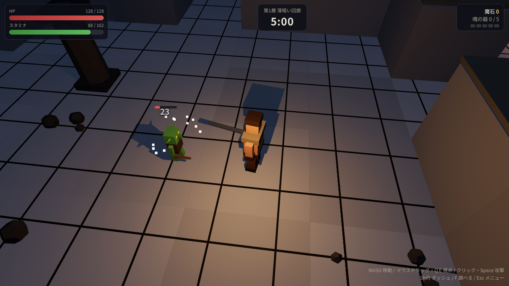
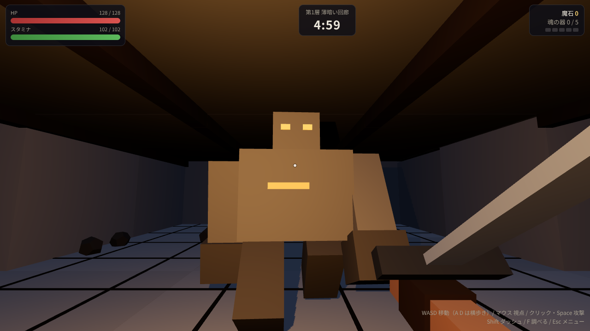
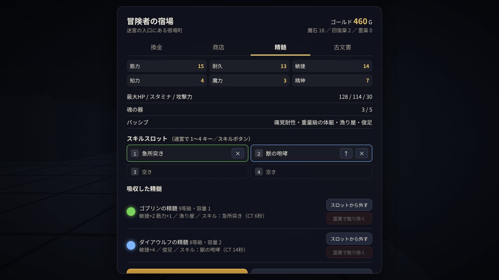
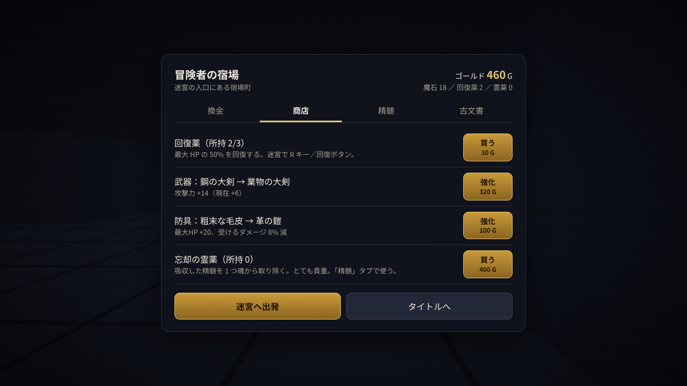
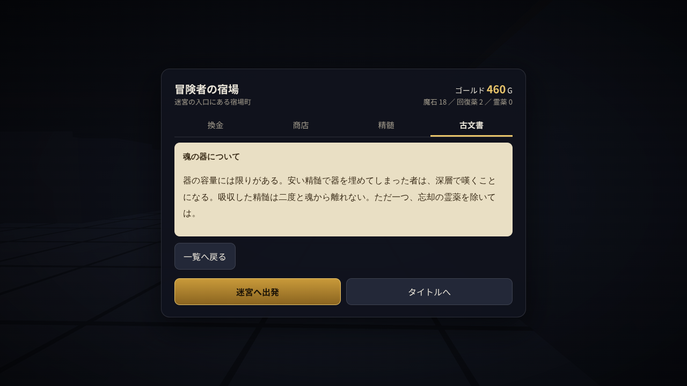
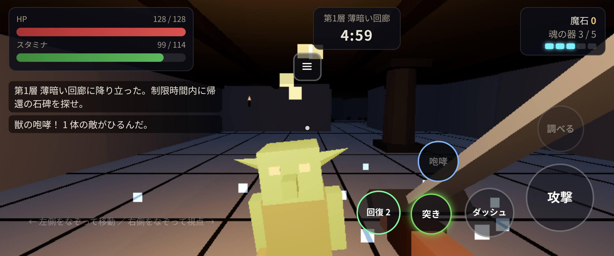

# 精髄の迷宮（ESSENCE LABYRINTH）

一人称視点の 3D ダンジョン探索型 RPG。ゲーム本体は Web 技術（Three.js）で作り、将来 Android アプリ（Capacitor）と
Windows 用ソフト（Electron）として配布する予定です。開発方針は [CLAUDE.md](CLAUDE.md) を参照。



第1層の上から見た図（探索ごとに地形が変わる）：[docs/screenshots/floor1_map.png](docs/screenshots/floor1_map.png)

| ストーンゴーレム | スマホ（タッチ操作） | 精髄の吸収 |
|---|---|---|
|  |  |  |

## 遊び方（開発中の確認）

```bash
cd web
python3 -m http.server 8000
# ブラウザで http://localhost:8000/ を開く（スマホからは同じ LAN の PC の IP:8000）
```

| 操作 | PC | スマホ |
|---|---|---|
| 移動 | W S 前後・A D 横歩き / ↑↓ | 画面左側をなぞる（仮想スティック） |
| 視点 | マウス（画面をクリックするとマウスがゲームに固定される。ドラッグでも可）/ Q・E / ←→ | 画面右側をなぞる |
| 攻撃 | 左クリック / Space / J | 攻撃ボタン |
| ダッシュ | Shift | ダッシュボタン（押している間） |
| スキル（スロット 1〜4） | 1〜4 | スキルボタン（セットしたものだけ表示） |
| 回復薬 | R | 回復ボタン |
| 調べる（精髄・門） | F / Enter | 調べるボタン |
| メニュー（一時停止・野営・帰還の巻物） | Esc / P（マウスの固定も外れる） | ≡ ボタン |

## Android アプリ（APK）

```bash
npm install                      # Capacitor（初回のみ）
npm run android:build            # web/ を android/ にコピーして、デバッグ版 APK をビルド
# → android/app/build/outputs/apk/debug/app-debug.apk
```

* Android SDK（platform 36・build-tools 36.0.0）と JDK 21 が必要。`android/local.properties` に `sdk.dir=<SDK の場所>` を書く
  （クラウド環境「3Dtest」ではセットアップスクリプトで用意される）
* アイコン・起動画面を作り直すとき：`python3 tools/make_android_assets.py`
* アプリ版の仕様：横画面固定、全画面（バーは画面端からスワイプで一時表示）、プレイ中は画面が消えない。
  戻るボタンは 探索中→一時停止 / メニュー→閉じる / 結果→拠点 / 拠点→タイトル / タイトル→終了

スマホへのインストール：APK をスマホにダウンロードして開き、「提供元不明のアプリ」のインストールを許可する。
デバッグ版の署名はビルドした環境ごとに変わるため、別の環境でビルドした APK は上書きインストールできない
（いったんアンインストールが必要で、その際セーブデータも消える）。

### 遊びの流れ

タイトル → **拠点**（換金・買い物・ビルド調整）→ 開放日に **迷宮** へ（いる層が閉ざされる日まで探索）→ 結果 → 拠点 …

### 迷宮の開閉・階層閉鎖のサイクル（`web/time.js`）

| 項目 | ルール（数値は `data.js` の `TIME` / `FLOORS`） |
|---|---|
| 地上ゲート | 30 日周期（`cycleDays`）。各周期の 1 日目（開放日）の入場フェイズ（0:00〜6:00、`gateOpenHours`）だけ入場できる。閉じている間は、拠点の「次の開放日まで過ごす」で次の周期の Day 1 へ。開放日は都市でも時間が流れ（迷宮と同じ速さ）、拠点で過ごした時刻に入場する |
| 降り立つ場所 | 第1層はランダム（暗黒地帯以外）。閉門まで 1 時間を切ってから入ると（`lateEntryHours`）、50% の確率で暗黒地帯に降り立つ（`lateDarkChance`）。拠点にも警告が出る |
| 階層の閉鎖 | 突入した瞬間を 0 時間とし、第1層 168 時間（7日目）・第2層 240 時間（10日目）・第3層 360 時間（15日目）で閉鎖（`closeHours`。第4層は仮に 456 時間） |
| 帰還 | いる層の閉鎖時間に達した瞬間、地上へ強制送還（＝帰還成功。魔石はすべて持ち帰る） |
| 力尽きたとき | 迷宮に入る直前の状態に戻る（所持品・装備・精髄・ステータス・ゴールド・日付もすべて出発前。地上ゲートは開いたままなのですぐ再挑戦できる。探索回数だけ記録される） |
| 下層への門 | くぐると 1 つ下の層へ。強制送還はその層の閉鎖時間まで延びる |
| 上層への門 | くぐると 1 つ上の層へ（早く帰りたいときの手段）。上の層がすでに閉ざされていたら門も閉ざされていて通れない |
| 門 | 第1層は東西南北の 4 つの門（それぞれ第2層の別のエリアへ）。第2層の各エリアには第1層へ戻る門と第3層への門（ゴブリンの森は石碑）。第3層の中心に第4層への門 |
| 次元の亀裂 | `isSpecialRift: true` の特殊な層。`timeMode` が `'stopped'`（中では時間が止まる）または `'surface'`（時間は流れるが閉鎖しない）。第2層の各エリアにまれに入口が現れる |
| ゲーム内の時間 | 迷宮の中だけで進む（1 日 = 実時間 5 分、`secondsPerDay`）。日付が変わると離れた場所に魔物が湧く |
| 野営 | メニューから。近くに魔物がいなければ 1 日進めて HP を回復（閉鎖日を越える場合は閉鎖日で止まる） |
| 迷宮から出る方法 | ① いる層の閉鎖で送還 ② 力尽きて出発前に戻る ③ 帰還の巻物などの特殊な効果（その場から地上へ。魔石は持ち帰る）。探索の放棄はできない |
| 帰還の巻物 | いまは入手できない（`HUB.returnScroll.inShop: false`。入手方法は今後追加）。1 個まで持てる。メニューから読む。近くに魔物がいると読めない。帰還の魔法などを追加するときは `game.js` の `returnToSurface(名前)` を呼ぶ |

探索画面の上部に「Day X HH:MM」と「この層の閉鎖まで あと X 日 Y 時間」を常に表示する（残り 1 日を切ると赤く点滅）。
**オートセーブ**：拠点では操作のたびに、探索中は 5 秒ごと・階層の移動・精髄の吸収・日付の変化・メニューを開いたとき・アプリが裏に回ったときに保存する。
探索中にアプリを終了しても、次の起動でタイトルの「続きから」を押すと、同じ階層・位置・時刻・HP・魔物と門の配置で再開できる。

### 迷宮の構造（第1〜3層）

地形は突入ごとに変わる（`web/mapgen.js`。探索ごとの種から作るので、同じ探索中・オートセーブからの再開では同じ地形）。
魔物は等級（9〜1）ごとに強さが決まり、群れで現れる（`data.js` の `MONSTERS` / `FLOORS[].regions`）。

| 階層 | 構造・ギミック | 主な魔物 |
|---|---|---|
| 第1層 水晶の洞窟（168 時間） | 十字形の洞窟。ライトクリスタルの周りだけ明るく、急カーブの多い迷路。外周の回廊はすべて暗黒地帯で、迷路とのあいだは壁（入れるのは通路の突き当たりの 8 か所だけ）。東西南北の腕の先、暗黒地帯の奥に第2層への門。中心の空洞と記念碑の周りは安全地帯（魔物が入らない・追ってこない）。まれに「深淵の侵食」で 5 等級の深淵の個体が現れる | 9 等級。北 ゴブリン（単体か数匹・1 匹ずつおびき寄せやすい）／東 刃狼（3〜5 頭の群れ。1 頭が気づくと群れ全体で囲い込む）／南 グール・西 ノーム（単体で徘徊。戦闘の気配で近くの同種が集まり、別個体が次々と湧く）／中心部 混在（戦い始めると周囲の別種も巻き込んで乱戦に） |
| 第2層 獣の巣窟（東の門から） | 分岐が極めて多い峡谷（迷いやすい） | 巨大刃狼・血刃狼・壁モグラ・壁モグラの女王・月輪岩熊・角猪（9）、サーベルタイガー・ウェアウルフ（8） |
| 第2層 亡者の地（南の門から） | 暗くぬかるむ大地と石造りの残骸。罠はなく、北へ直進すれば第3層への門。バンシーの泣き声が響く | グール・エルダーグール・スケルトン 3 種・バンシー（9）、デスフィーンド・キメラウルフ・グールロード（8）、まれにデュラハン（7）・デスナイト（6） |
| 第2層 岩の砂漠（西の門から） | 砂と岩山、松明に照らされた残骸 | ノーム・堕落したノーム・コボルド 3 種（9）、ストーンゴーレム・巨石兵・サンドマン・サンドワーム（8）、ごくまれにデスワーム（5） |
| 第2層 ゴブリンの森（北の門から） | 星明かりで比較的明るい森。見えない罠が無数にある。8 つの石碑のうち本物は 1 つ（開くと残り 7 つは石塊に） | ゴブリン・ゴブリン剣士・ゴブリン弓兵（9）が十数体の群れ、外周部にホブゴブリン（7） |
| 第3層 巡礼者の道（360 時間） | 11 のフィールドからなる広い 1 つの階層。第2層のどのエリアから来ても合流し、到着地点だけが方角で変わる。中心の尖塔に第4層への門 | 下の表 |

| 第3層のフィールド | ギミック | 魔物 |
|---|---|---|
| 魔女の森（中心） | 「魔女の目」：滞在 4 時間ごと・魔物を倒すごとに 1 段階（最大 10）。最大で同じ場所に 3 分留まると人喰い樹（7）が現れる。霊体（レイス）には通常攻撃が効かない（精髄スキルなら効く） | フェアリー・レイス・ウィッチズランプ・ウッドマン（9）、蛇樹・根喰い・突然変異した下級精霊・ホムンクルス・アウルベア・ドライアド（8）、ハーフトロール（7） |
| 鋼岩の丘 | 3 日目に地面から銀色の光の球が空へ舞う | アウルベアなど |
| オークの群落地 | オークを 30 体倒すとオークヒーロー（5）、ヒーローを倒して 80 体でオークロード（2） | オーク戦士・弓兵・呪術師（8）、オーク大戦士（7） |
| 緑尾の湿地 | 足を取られて移動が遅くなる | 根喰い・蛇樹など |
| 石像の遺跡 | 無名の石像だけが出る | 無名の石像（7） |
| ほか 6 フィールド | 巡礼者の街道・霧の平原・古戦場・枯れ谷・風の草原・北の巡礼門 | 第3層の魔物 |

弓兵・魔法使い系の魔物は離れた所から弾を撃ってくる（よければ当たらない）。いるフィールドの名前は画面上部に出る。
原作にしかない固有名詞は、一般的な名前に置き換えている（例：蛇樹・根喰い・角猪・人喰い樹・記念碑・深淵の侵食）。

### Step 2 で追加したこと

| 拠点：精髄（ビルド調整） | 拠点：商店 |
|---|---|
|  |  |

| 古文書 | スマホ：スキル・回復ボタン |
|---|---|
|  |  |

* **精髄スキル**：吸収した精髄のスキルを最大 4 つのスロットにセットして使う（再使用まで待ち時間あり）
  * 急所突き（ゴブリン）：前方へ通常攻撃の 2.4 倍の突き
  * 獣の咆哮（刃狼）：周囲 7m の敵を 2.5 秒ひるませ、攻撃を中断させる
  * 岩の構え（ストーンゴーレム）：6 秒間、受けるダメージを 65% 減らす
* **拠点「冒険者の宿場」**
  * 換金：魔石を等級ごとに売る（9 等級 10 G 〜 1 等級 7000 G）
  * 商店：回復薬（最大 3 個まで持てる）、帰還の巻物（1 個まで）、武器の強化（鋼の大剣 → 業物の大剣）、防具の強化（革の鎧 → 鎖帷子）、
    忘却の霊薬（吸収した精髄を 1 つ取り除ける。400 ゴールド）
  * 精髄：ステータス・パッシブの確認、スキルスロットの入れ替え・並べ替え、霊薬で精髄を取り除く
  * 古文書：ゴールドで購入、または条件（特定の魔物の累計撃破数）を満たすと無料で読める攻略メモ
* 回復薬は迷宮で使える（最大 HP の 50% 回復）。モンスターごとの累計撃破数を記録

### Step 1 でできること

* 一人称視点で迷宮（4m 四方のマス目でできた回廊と部屋）を探索。第1〜4層と次元の亀裂（深い層ほど魔物が強い）
* 階層の構成は下の「迷宮の構造（第1〜3層）」を参照
* 体の型（二足・四足・大型・霊体・地を這う・樹木）を作り分けた約 50 種の魔物。索敵・経路探索で追跡し、予備動作（赤く光る）のあとに攻撃
* 近接攻撃（スタミナ消費）、ダッシュ。ヒットストップ・ノックバック・ダメージ数字・粒子で手応えを表現
* 倒すと魔石を必ず 1 個落とす（自動で拾う）。魔石には等級（9 等級〜1 等級）があり、強い魔物・深い層・亀裂の主ほど高い等級になる
  （例：第1層のゴブリン 9 等級、第2層のゴーレム 6 等級、亀裂の主 3 等級。等級ごとの買取価格は `data.js` の `STONE_GRADES`）
* 精髄オーブはまず落ちないレア（通常の魔物は 0.2〜1%）。次元の亀裂の奥にいる「亀裂の主」（大きく強いボス）は 33% で落とす
  （確率は `data.js` の `MONSTERS[].drops` と `BOSS.essenceChance`）
* 精髄の吸収：魂の器（容量 5）の範囲内で吸収。同じ精髄の重複不可・取り除けない。吸収するとステータスとパッシブが即座に反映
  （吸収できない精髄は砕いて魔石にできる）
* いる層の閉鎖で地上へ送還されると魔石を持ち帰れる。力尽きると迷宮に入る直前に戻る（上の「開閉サイクル」を参照）
* セーブは自動（オートセーブ。探索の途中からも再開できる）。画質の切り替え（高：PC 向け／低：スマホ向け）

## 構成

```
web/                … ゲーム本体（Android・PC 共通）
  index.html        … 画面（HUD・タッチ操作・タイトル・吸収・メニュー・結果）
  game.js           … ゲームループ、ダンジョン、プレイヤー、敵 AI、戦闘、精髄・スキル、門と階層の移動
  time.js           … ゲーム内時間（TimeManager）・地上ゲートの開閉・階層の閉鎖判定（checkFloorClosure）
  hub.js            … 拠点の画面（換金・商店・精髄・古文書）
  models.js         … キャラクター・モンスター・アイテムのローポリモデル（基本形状の組み合わせ）
  stones.js         … 魔石の等級（等級ごとの個数の扱い・魔物が落とす等級の計算）
  mapgen.js         … 突入ごとに変わる地形を作る（第1層の水晶の洞窟・第2層の 4 エリア・第3層の巡礼者の道）
  data.js           … マスターデータ（種族・精髄・スキル・モンスター・階層・古文書・拠点の値段）。数値の調整はここ
  storage.js        … セーブ・ロード（本体のセーブ／迷宮に入る直前のセーブ／探索中のオートセーブ。保存先を差し替えられるよう抽象化）
  input.js          … 入力の抽象化（キーボード／マウス／タッチ）
  vendor/three/     … Three.js r170（同梱。CDN 不要）
blender/
  bpy_kit.py         … 形を組む部品（箱・円柱・リング・チューブ・球）、マテリアル（単色・画像・写真素材の PBR）、
                        当たり判定と「調べる」対象の記録、glTF への書き出し、テクスチャの JPEG 化
  fetch_textures.py  … Poly Haven（CC0）から PBR テクスチャと HDRI を取得
  text_textures.py   … 日本語の看板・貼り紙などのテクスチャ作成（OS ごとのフォント自動検出、古び加工）
  example_build.py   … 使い方の例（床・レンガの壁・木箱・看板・柱と電線を作って書き出す）
  cache/             … ダウンロードした素材（git 管理外）
assets/
  models/            … 書き出したモデル（.gltf + .bin、テクスチャは models/textures/ で共有）
  textures/          … 自分で作ったテクスチャ
```

## 使い方

```bash
python3 blender/example_build.py
# → assets/models/example.gltf / example.json、blender/example.blend
```

新しいゲームでは `example_build.py` をコピーして書き換えていきます。

```python
import bpy_kit as K, fetch_textures as PH, text_textures as TT

K.reset_scene()
brick = K.pbr_mat("brick", *PH.ensure_texture("red_brick_03", "1k"), metal=0.0)  # 写真素材（実寸で繰り返す）
b = K.Builder("Stage")
b.box((-5, 4.5, 0), (5, 5, 4), brick, collide=True)   # Blender 座標（Z が上、単位 m）
obj = b.finish()
K.export_gltf(obj, "assets/models/stage.gltf")
```

* 写真素材は https://polyhaven.com で探せます（ID は URL の最後の部分）。
  `python3 blender/fetch_textures.py <ID> [1k|2k]` で単体でも取得できます。すべて CC0 です。
* `b.collider(...)` / `collide=True` で当たり判定の箱、`b.interact(...)` で「調べる」対象を記録し、
  `b.colliders_gltf()` でゲーム側（glTF / three.js の Y-up 座標）の形にして書き出せます。
* 看板の文字は `TT.sign(...)`、古び加工は `TT.weather(...)`。

## 環境

Claude Code のクラウド環境「3Dtest」で動く前提です。環境側に次の設定があります。

* セットアップスクリプト：`fonts-noto-cjk`（日本語フォント）と `bpy==5.2.3`、`pillow` をインストール
* ネットワーク：`api.polyhaven.com` と `dl.polyhaven.org` への接続を許可

手元の PC で動かす場合は Python 3.13 が必要です（bpy 5.2.3 は Python 3.13 専用）。

```bash
python3.13 -m venv .venv && source .venv/bin/activate   # Windows は .venv\Scripts\activate
pip install bpy==5.2.3 pillow
```

日本語フォントは OS の標準フォントを自動で探します（macOS: ヒラギノ、Windows: 游ゴシック／メイリオ・游明朝）。
見つからないときは環境変数 `KIT_FONT_BOLD` / `KIT_FONT_REG` / `KIT_FONT_SERIF` でフォントファイルを指定します。
